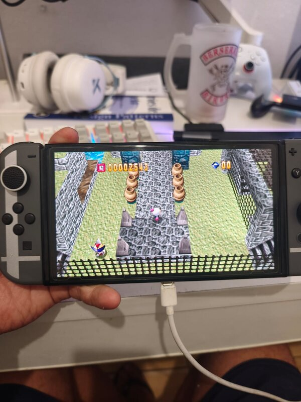
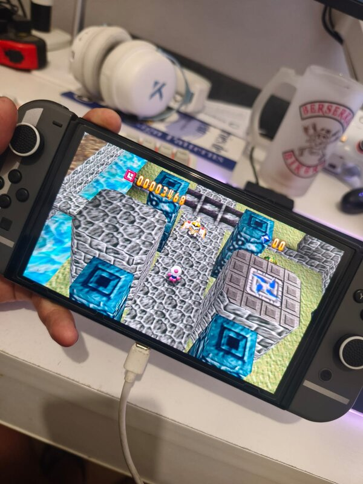
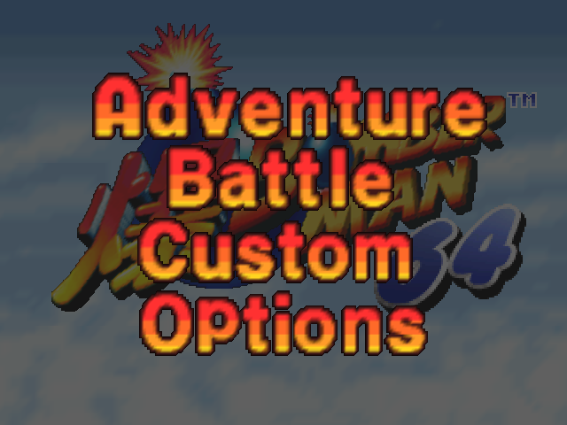
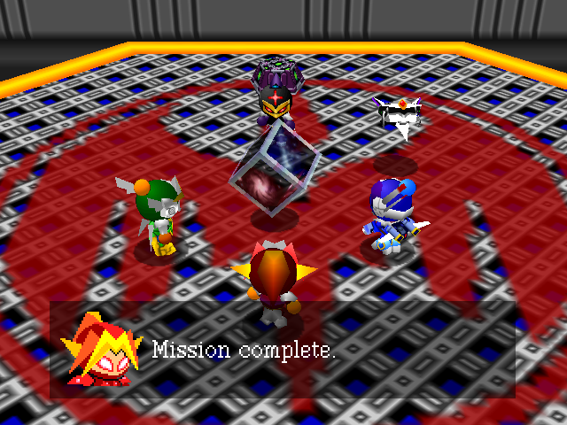
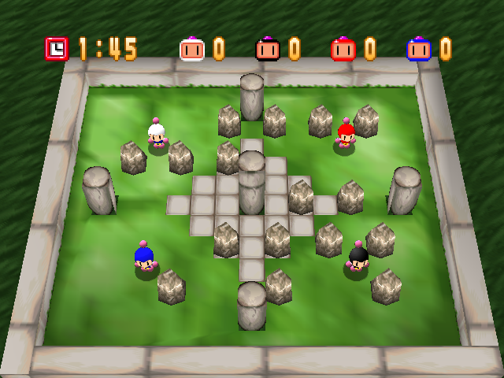
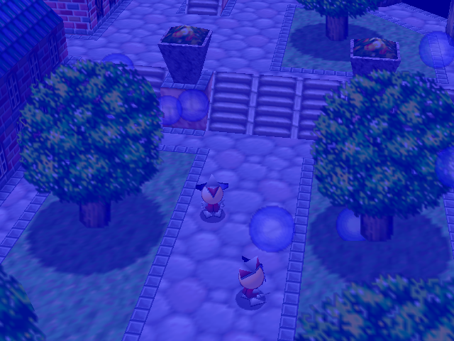

# Bomberman 64: Recompiled — Nintendo Switch

English | **[Português](README.pt-BR.md)**

> **Nintendo Switch port developed by [Paulo Dias](https://github.com/paulodiasred).**
> If you enjoy it, leave a ⭐ on the repository!

<p align="center">
  
  
  <br><em>Running on a real Nintendo Switch OLED.</em>
</p>

A Nintendo Switch homebrew port (`.nro`) of [Bomberman 64: Recompiled](https://github.com/RevoSucks/BM64Recomp).
The game code is statically recompiled from the original ROM with [N64Recomp](https://github.com/N64Recomp/N64Recomp)
and runs on [N64ModernRuntime](https://github.com/N64Recomp/N64ModernRuntime). The PC version renders with RT64
(Vulkan/D3D12/Metal), which isn't available on the Switch. This port renders with the Fast3D renderer from
[libultraship](https://github.com/YoshiCrystal9/libultraship) over OpenGL, and its settings menu uses ImGui.

| | |
|---|---|
|  |  |
|  |  |

*Screenshots from the port's renderer (the same one used on the Switch).*

**This repository contains no game assets. You need your own Bomberman 64 (USA) ROM to build and to play.**

## Installing on the Switch

You need a Switch running Atmosphère and your own **Bomberman 64 (USA)** ROM. Download the game from the
**[Releases page](https://github.com/paulodiasred/BM64Switch/releases)**. There are two ways to install it:

### Option 1: NSP (recommended): icon on the HOME menu

1. Install `BM64Recompiled.nsp` with a title installer (DBI, Tinfoil, Goldleaf...). Installing NSPs requires
   sigpatches in Atmosphère.
2. Put your ROM on the SD card (see [Where to put the ROM](#where-to-put-the-rom)).
3. Open **Bomberman 64: Recompiled** from the HOME menu, like any other game.

### Option 2: NRO (no installation)

1. Copy `BM64Recompiled.nro` to `sdmc:/switch/` on the SD card.
2. Put your ROM on the SD card (see below).
3. Launch it from the Homebrew Menu in **title override mode**: hold **R** while opening any game. The album (applet
   mode) doesn't have enough memory.

### Where to put the ROM

Any of these places works:
- `sdmc:/switch/bm64recomp/` (created by the game on first launch),
- `sdmc:/switch/`,
- the root of the SD card (`sdmc:/`).

Any format (`.z64`, `.n64` or `.v64`) and any file name. On first launch the ROM is validated and copied to
`sdmc:/switch/bm64recomp/`, so you can delete the original afterwards. That folder also holds settings, saves, the
shader cache and the logs (`bm64.log`, `bm64-err.log`). The NSP and the NRO share it.

**Settings menu:** press **−** (Minus) to open or close it. It has these tabs:
- **Graphics:** internal resolution, anti-aliasing, texture filtering, VSync, FPS and the Switch CPU clock.
- **Sound.**
- **Controls:** rumble, deadzone and remapping.
- **Cheats.**

Settings are saved when the menu closes.

## Building

Everything runs in Docker, so on Windows you only need Docker Desktop and PowerShell. Clone with submodules:

```powershell
git clone --recurse-submodules https://github.com/paulodiasred/BM64Switch.git
cd BM64Switch
```

| Command | What it does |
|---|---|
| `.\build.ps1 generate C:\path\bomberman64.z64` | Once: decompresses the ROM and recompiles the game (`RecompiledFuncs/`), the audio microcode (`rsp/aspMain.cpp`) and the patches (`RecompiledPatches/`). |
| `.\build.ps1 switch` | Builds `dist\BM64Recompiled.nro`, plus the `.elf` for reading crash reports. |
| `.\build.ps1 all C:\path\bomberman64.z64` | `generate` + `switch`. |
| `.\build.ps1 nsp C:\path\prod.keys` | Builds `dist\BM64Recompiled.nsp`. Needs your console's `prod.keys` (Lockpick_RCM). Only the packing step reads them, with just the two keys it needs, in a container without network access, and they never go into the repository. |
| `.\build.ps1 override <title ID>` | Without keys: an Atmosphère LayeredFS folder in `dist\sd` that runs the game in place of an installed title, to test the NSP build. |
| `.\build.ps1 patches` | Recompiles only the patches, after editing `patches\*.c`. |
| `.\build.ps1 linux` | Linux test build (same code and renderer) in `build-linux\`. |
| `.\build.ps1 test run.sh SHOTS="10 20 30"` | Linux build + headless run of a `tools\test\` script, which takes screenshots in `run\`. The ROM must be in `run\`. |
| `.\build.ps1 shell` | Opens a shell in the tools Docker image. |
| `.\build.ps1 clean` | Deletes `build-linux\`, `build-switch\` and `dist\`. |

The first run creates two Docker images:
- `bm64switch-host`: Ubuntu with clang, N64Recomp, Xvfb and Mesa.
- `bm64switch-nx`: devkitA64 with libnx.

It also downloads and builds tools into `build-tools\`: N64Recomp, and `bm64decompress` from the
[decompilation project](https://github.com/Bomberhackers/bm64).

Nothing generated from the ROM may be committed. The `.gitignore` already covers ROMs, `RecompiledFuncs/`,
`RecompiledPatches/`, `rsp/` and the patch binaries.

## Layout

- `src/lus/`: the renderer.
  - `dl_translator.cpp` translates F3DEX display lists and RT64's extended GBI for libultraship. It also emulates the
    motion blur framebuffer and the fog-based fades.
  - `lus_render_context.cpp` is the render context.
  - `lus_menu.cpp` is the ImGui menu.
  - The other files replace the PC version's RmlUi UI.
- `src/switch/`: Switch glue.
  - 2 MB stacks and cleared TLS for threads created through `pthread_create`.
  - sljit configured without executable memory.
- `lib-patches/`: changes to the submodules (N64ModernRuntime, N64Recomp and libultraship). `tools/setup.sh` applies
  them, and `build.ps1` runs it automatically.
- `patches/`: game patches (C for MIPS), recompiled along with the game.
- `third_party/rt64/`: the extended GBI header and the `file_to_c` tool, copied from RT64 (MIT).
- `tools/test/`: headless test scripts.
  - `run.sh`: screenshots at fixed times.
  - `play.sh`: a sequence of key presses and screenshots.
  - `audio.sh`: audio levels.
  - `gdbrun.sh`: backtrace.

## Debugging

- **Logs:** `sdmc:/switch/bm64recomp/bm64.log` and `bm64-err.log`.
- **Atmosphère crash reports:** they're in `sdmc:/atmosphere/crash_reports/`. To read them, use
  `aarch64-none-elf-addr2line -e dist/BM64Recompiled.elf <offset>` in the `bm64switch-nx` image, with the offsets
  inside the game module.
- **Display list dumps:** `BM64_DL_DUMP=N` (Linux build) writes every Nth frame's display list to `dl_<frame>.txt`.

## Known limitations

- Code mods don't work: homebrew can't create executable memory.
- The NRO in applet mode (album) doesn't have enough memory. Use the NSP or title override.
- The first time an effect appears it can still hitch briefly while its shader compiles. Shaders are saved to
  `shaders.bin` and precompiled on later launches.

## Credits

- **[Paulo Dias](https://github.com/paulodiasred):** Nintendo Switch port (libultraship renderer, display list
  translator, ImGui menu, Switch runtime adaptations and build).
- [BM64Recomp](https://github.com/RevoSucks/BM64Recomp) (RevoSucks and contributors): the base of this port.
- [N64Recomp / N64ModernRuntime](https://github.com/N64Recomp) (Wiseguy and contributors).
- [libultraship](https://github.com/Kenix3/libultraship) and the Switch fork by
  [YoshiCrystal9](https://github.com/YoshiCrystal9/libultraship).
- [RT64](https://github.com/rt64/rt64): extended GBI and `file_to_c`.
- [Bomberhackers/bm64](https://github.com/Bomberhackers/bm64): decompilation and `bm64decompress`.

The original project's license is in [LICENSE.txt](LICENSE.txt).
